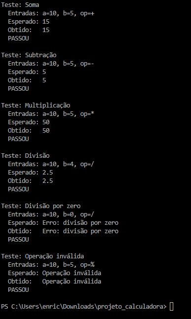
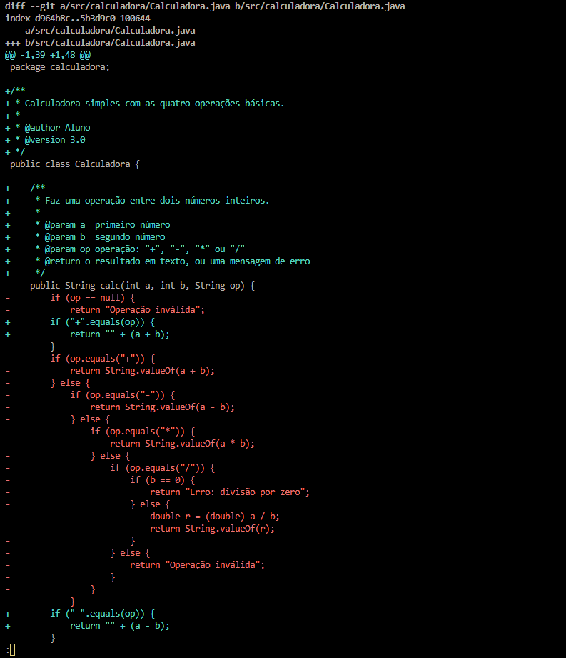
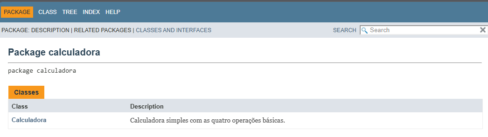

# Projeto Calculadora — FinançApp

Projeto acadêmico desenvolvido com foco em Qualidade de Software, Testes, Refatoração, Documentação e Versionamento.

## 1. Identificação do Projeto

| Campo | Informação |
|---|---|
| Projeto | Projeto Calculadora |
| Contexto | FinançApp |
| Aluno | Enrico Pimentel Gotti Encarnação |
| RA | 250779 |
| Curso | Análise e Desenvolvimento de Sistemas |
| Disciplina | UX UI e Testes de Software |
| Professor | Ohata |
| Semestre | 2026.2 |

## 2. Visão Geral

O projeto consiste no desenvolvimento de um módulo de cálculos matemáticos básicos em Java para a startup fictícia FinançApp.

O módulo foi desenvolvido para ser utilizado futuramente em funcionalidades de controle financeiro, como:

- orçamento mensal;
- divisão de despesas;
- projeções financeiras;
- cálculos auxiliares.

Além do funcionamento correto das operações, o projeto aplica práticas de qualidade de software relacionadas a:

- testes;
- tratamento de erros;
- refatoração;
- documentação;
- versionamento;
- manutenção de código.

## 3. Problema

Durante o desenvolvimento da aplicação FinançApp, foi identificada a necessidade de criar um módulo matemático reutilizável.

A equipe definiu que o módulo não deveria apenas funcionar corretamente, mas também apresentar:

- código legível;
- testes;
- tratamento de falhas;
- documentação técnica;
- controle de versões;
- facilidade de manutenção.

O desafio consiste em desenvolver uma solução funcional e, ao mesmo tempo, aplicar boas práticas de Engenharia de Software.

## 4. Objetivo

### 4.1 Objetivo Geral

Desenvolver uma calculadora em Java aplicando práticas de qualidade, testes, documentação, refatoração e versionamento.

### 4.2 Objetivos Técnicos

- implementar operações matemáticas básicas;
- tratar entradas inválidas;
- impedir divisão por zero;
- desenvolver testes;
- refatorar o código sem alterar seu comportamento;
- documentar classes e métodos com JavaDoc;
- gerar documentação HTML;
- utilizar Git e GitHub;
- organizar commits e branches;
- manter documentação técnica no README.

## 5. Escopo Funcional

| ID | Funcionalidade | Descrição | Status |
|---|---|---|---|
| RF01 | Soma | Soma dois números inteiros | ✅ |
| RF02 | Subtração | Subtrai dois números inteiros | ✅ |
| RF03 | Multiplicação | Multiplica dois números inteiros | ✅ |
| RF04 | Divisão | Divide dois números inteiros | ✅ |
| RF05 | Validação de divisão | Impede divisão por zero | ✅ |
| RF06 | Operação inválida | Trata operadores não suportados | ✅ |

## 6. Requisitos Não Funcionais

| ID | Categoria | Requisito |
|---|---|---|
| RNF01 | Qualidade | O código deve possuir organização e legibilidade |
| RNF02 | Testabilidade | As operações devem possuir testes |
| RNF03 | Manutenção | O código deve permitir refatoração sem alteração funcional |
| RNF04 | Documentação | Classes e métodos devem possuir JavaDoc |
| RNF05 | Versionamento | O projeto deve utilizar Git e GitHub |
| RNF06 | Confiabilidade | Erros não devem interromper inesperadamente a execução |

## 7. Tecnologias Utilizadas

| Tecnologia | Versão | Utilização |
|---|---|---|
| Java | 17 ou superior | Desenvolvimento |
| JDK | 17 ou superior | Compilação |
| Testes | Java puro (classe `TesteCalculadora` com `main`) | Testes |
| Git | 2.x | Controle de versão |
| GitHub | — | Repositório remoto |
| JavaDoc | — | Documentação |
| IDE | Nome da IDE | Ambiente de desenvolvimento |

## 8. Estrutura do Projeto

```
projeto_calculadora/
│
├── src/
│   └── calculadora/
│       └── Calculadora.java
│
├── test/
│   └── calculadora/
│       └── TesteCalculadora.java
│
├── docs/
│   └── index.html
│
├── images/
│   ├── testes/
│   ├── javadoc/
│   └── refatoracao/
│
├── README.md
├── .gitignore
└── demais arquivos do projeto
```

## 9. Explicação das Operações

O método principal é `calc(int a, int b, String op)`, que retorna o resultado como texto.

| Operação | Símbolo | Exemplo | Retorno |
|---|---|---|---|
| Soma | `+` | `calc(10, 5, "+")` | `15` |
| Subtração | `-` | `calc(10, 5, "-")` | `5` |
| Multiplicação | `*` | `calc(10, 5, "*")` | `50` |
| Divisão | `/` | `calc(10, 4, "/")` | `2.5` |
| Divisão por zero | `/` | `calc(10, 0, "/")` | `Erro: divisão por zero` |
| Operação inválida | qualquer outro símbolo | `calc(10, 5, "%")` | `Operação inválida` |

Nenhuma entrada inválida interrompe o programa: os erros são devolvidos como mensagens.

## 10. Como Compilar e Executar

```bash
mkdir out
javac -encoding UTF-8 -d out src/calculadora/*.java test/calculadora/*.java
java -cp out calculadora.TesteCalculadora
```

Para gerar o JavaDoc:

```bash
javadoc -encoding UTF-8 -docencoding UTF-8 -private -author -version -d docs src/calculadora/*.java
```

## 11. Testes

A classe `TesteCalculadora` cobre soma, subtração, multiplicação, divisão, divisão por zero e operação inválida. Cada teste mostra as entradas, o resultado esperado e o resultado obtido.

Prints da execução dos testes:



## 12. Refatoração (branch `Refatoracao`)

- Extração do método `dividir`, que trata a divisão por zero.
- `if/else` aninhados trocados por `if` simples em sequência.
- Melhoria de nomes de variáveis e adição de JavaDoc e comentários.

Após a refatoração, os testes foram executados novamente e todos passaram.



## 13. Documentação JavaDoc

A documentação HTML fica em `docs/`. Abra `docs/index.html` no navegador.



## 14. Repositório

Link do repositório: [https://github.com/rikkuGotti/projeto_calculadora](https://github.com/rikkuGotti/projeto_calculadora)
